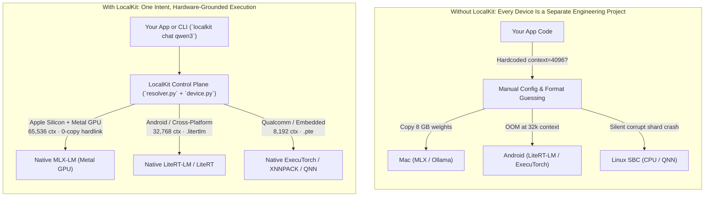
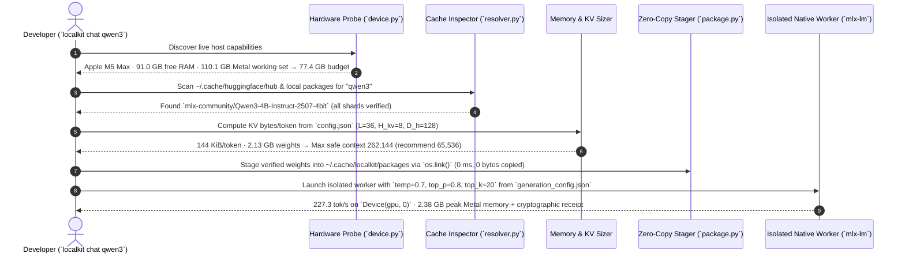

# How LocalKit Works

Shipping a local model across consumer hardware breaks down because **three variables change simultaneously on every device**:

1. **The Silicon & Harness:** An Apple M5 Max wants `.safetensors` on **MLX Metal**. A Pixel wants `.litertlm` on **LiteRT-LM**. A Snapdragon board or phone wants `.pte` on **ExecuTorch / QNN**.
2. **The Memory Envelope:** A 4B-parameter model with a 262K native context window uses **36 GB of KV cache** at full context. That fits effortlessly on a 128 GB Mac Studio, swap-thrashes a 16 GB MacBook Air, and instantly OOM-kills a 12 GB Android phone or 4 GB Linux SBC.
3. **The Author's Sampling Contract:** Every model family (`Qwen3`, `Gemma 4`, `DeepSeek`) ships different required `temperature`, `top_p`, `top_k`, and stop-token rules inside `generation_config.json`. Guessing `temperature=0.0` or the wrong chat template silently degrades output quality.

---

## 1. Without LocalKit vs. With LocalKit

---

## 2. Control Plane vs. Execution Plane

LocalKit **does not** replace native C++/Metal/NPU engines with a custom inference wrapper. Instead, it separates **resolution and memory physics** (the Control Plane) from **tensor execution** (the Execution Plane):

| Plane | Responsibility | Where It Lives |
| --- | --- | --- |
| **Control Plane** (`device.py`, `resolver.py`, `releases.py`) | Probes live silicon & reclaimable RAM, validates local model caches for missing shards, computes KV-cache budgets, reads `generation_config.json`, stages weights via zero-copy `os.link()`, and enforces tool permissions. | LocalKit Runtime |
| **Execution Plane** (`mlx-lm`, `litert-lm-api`, `executorch`, `ai-edge-litert`) | Executes matrix multiplications and attention kernels directly on Apple Metal, Google Tensor / GPU, Qualcomm Hexagon NPU, or ARM64 XNNPACK. | Native Vendor Harnesses |

---

## 3. Step-by-Step Lifecycle: What Happens When You Run `localkit chat qwen3`

### Step 1: Live Silicon & Memory Discovery (`device.py`)
Static total RAM (`128 GB` or `16 GB`) lies when the OS and other apps are already consuming memory. LocalKit queries:
- **Reclaimable System RAM:** Parses `vm_stat` (`free + inactive + speculative` pages on macOS) or `/proc/meminfo` (`MemAvailable` on Linux/Android).
- **Accelerator Working-Set Limits:** On Apple Silicon, queries `mlx.core.device_info()` for `max_recommended_working_set_size` and `max_buffer_length`.
- **Safe Inference Budget:**
  $$\text{Budget}_{\text{MB}} = \min\left(0.85 \times \text{Available RAM},\; 0.90 \times \text{GPU Max Working Set}\right)$$

### Step 2: Cache Integrity Audit (`resolver.py`)
Before attempting to load any model from `~/.cache/huggingface/hub`, LocalKit inspects the snapshot directory:
- Verifies that `snapshots/<revision>` exists (catching interrupted `huggingface-cli` or Python downloads that only left `.locks/`).
- Reads `model.safetensors.index.json` and verifies that **every referenced shard** is physically present on disk.
- If a model download is incomplete (for example, missing 131/131 shards or missing `snapshots/`), LocalKit immediately raises `incomplete_model_cache` with the exact broken file paths rather than crashing inside a C++ loader.

### Step 3: Physics-Based KV Cache & Context Sizing
Instead of hardcoding `context_length = 4096`, LocalKit reads the model's attention geometry from `config.json` (`num_hidden_layers` $L$, `num_key_value_heads` $H_{kv}$, `head_dim` $D_h$) and calculates the exact KV-cache footprint per token (assuming FP16 KV storage):

$$\text{KV Bytes per Token} = 2 \times L \times H_{kv} \times D_h \times 2$$

After subtracting model weight bytes and a 15% activation reserve from the live inference budget, LocalKit computes the maximum context window that physically fits in memory without swapping, and snaps to a clean power-of-two ceiling (`65536`, `32768`, `16384`, `8192`, `4096`).

### Step 4: Zero-Copy Hardlink Staging (`package.py`)
LocalKit verifies every weight file by SHA-256 and stages runnable packages using `os.link()` (`link_or_copy`). A 16 GB model stages in milliseconds with **zero duplicated disk space**, while still isolating the worker process so stray or unverified files in a cache directory are never read.

---

## 4. Cross-Device Target Locking (`localkit add` → `localkit.lock.json`)

When you run `localkit add qwen3`, LocalKit evaluates your model's exact weight footprint and KV-cache physics across four standard consumer hardware profiles and writes `localkit.lock.json`:

| Target Profile | Reference Hardware | Inference Budget | Resolved Context (`Qwen3-4B-4bit`) | Native Harness |
| --- | --- | --- | --- | --- |
| `apple_silicon_128gb` | Mac Studio / MacBook Pro (M5 Max) | 98,304 MB | **65,536 tokens** (9.0 GB KV) | `mlx` (Metal GPU) |
| `apple_silicon_16gb` | MacBook Air / Pro (16 GB) | 11,468 MB | **65,536 tokens** (9.0 GB KV) | `mlx` (Metal GPU) |
| `android_flagship_12gb` | Pixel 11 Pro XL / Galaxy S25 (12 GB) | 5,632 MB | **16,384 tokens** (2.25 GB KV) | `litert_lm` / `executorch` |
| `edge_sbc_4gb` | Arduino Ventuno Q / RPi 5 (4 GB) | 2,457 MB | **8,192 tokens** (1.12 GB KV) | `litert_lm` / `executorch` |
